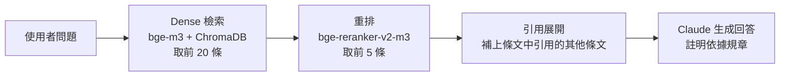

# 人資規章問答 RAG

以公司人資規章為知識來源的問答系統。員工用口語提問（例如「新人有幾天特休？」），系統從規章中找出相關條文，交給 Claude 生成回答，並註明依據的規章與條號。

專案同時包含一套評估流程，分別衡量「有沒有找到對的條文」與「回答得對不對」，讓每次調整都能用數字比較。

> 範例規章為虛構的「無限股份有限公司」人資辦法（HR-01 ～ HR-07），僅供 RAG 測試使用。

## 運作流程



1. **切分**：以條文（`### 第N條`）為單位切分，移除 front matter、文件標題與章標題。
2. **表格列子 chunk**：含表格的條文（例如薪資項目表）每一列另外建立一個子 chunk 做 embedding，避免單一項目的資訊被整條條文稀釋；檢索命中子 chunk 時，送出的仍是整條條文。
3. **Dense 檢索**：用 `BAAI/bge-m3` 將問題轉成向量（已正規化），在 ChromaDB 中取出最相近的 20 條條文。
4. **重排**：用 CrossEncoder `BAAI/bge-reranker-v2-m3` 對候選條文重新打分，取前 5 條。
5. **引用展開**：條文中明確引用的其他條文（例如 HR-07 第19條「依工作規則（HR-01）第17條至第22條」）會一併送出，最多補 8 條，只展開一層。引用關係在 ingest 時就已解析好。
6. **生成回答**：以 Claude（`claude-sonnet-5-5`）根據條文回答。條文不足以回答時回答「不知道」；條文依據外部法規（例如勞基法）但未收錄其內容時，只說明依據該法規，不自行補充。

## 評估結果

| 指標 | 改版前 | 改版後 |
|---|---|---|
| 相關條文全部送到 LLM（20 題） | 85% | **100%** |
| 跨文件題相關條文全部送到 LLM | 40% | **100%** |
| 改寫問法後仍全部送到 LLM（22 題） | 59% | **91%** |
| 回答完全正確 | — | **90%** |
| 回答忠實於條文（沒有編造） | — | **100%** |
| 回答註明依據的規章 | — | **100%** |

改版前：以條文切分、rerank 後送前 3～5 條；改版後：加入表格列拆分與引用展開。評估方式見[評估方法](#評估方法)。

### 開發歷程

| 階段 | 改動 | 原因 |
|---|---|---|
| 1 | 以條文為單位切分，記錄來源規章 | 段落切得太碎，回答無法附上依據 |
| 2 | 送給 LLM 的條文從 3 條增加到 5 條 | 跨文件題需要多條條文，reranker 常把其中一條排到第 4 名 |
| 3 | 措辭敏感度實驗（同一題改寫成 4 種問法） | 確認失敗來自少數難以檢索的條文，而不是使用者的問法 |
| 4 | 表格列拆分 | 表格條文混合多個項目，單一項目的語意被稀釋 |
| 5 | 引用展開 | 有些條文和問題用詞差距大、難以檢索，但會被其他條文明確引用 |
| — | BM25 混合檢索 | 試過，沒有帶來改善，已移除 |

### 主要發現

- **檢索很少漏掉，損失在 rerank 之後**：跨文件題需要 2–3 條條文，送出數量不足時常缺一條。
- **口語化不影響，缺少關鍵概念才會**：語氣改變不影響結果；問題沒有提到關鍵概念時，相關條文才會掉出。
- **不編造與合理推論的取捨**：要求只根據條文回答、不補充外部法規，讓回答沒有幻覺，但需要推論時偏保守，扣分的兩題都是這個原因。

### 限制

- 題組規模小（20＋22 題），結果僅反映趨勢；開發用題組的分數可能偏高，因此另以改寫題組驗證。
- 回答品質由 LLM（`claude-opus-5-5`）評分，建議抽樣人工確認。

## 專案結構

| 檔案 | 說明 |
|---|---|
| `config.py` | 設定：規章資料夾、embedding 模型、reranker 模型、資料庫路徑、collection 名稱 |
| `store.py` | 共用元件：embedding 模型、ChromaDB 連線、`embed_chunk()`。寫入與查詢都經過這裡，確保向量規則一致 |
| `ingest.py` | 讀取規章 → 切分條文 → 解析引用 → 產生表格列子 chunk → 計算 embedding → 寫入資料庫 |
| `refs.py` | 解析條文中的引用：內部條文（含「第17條至第22條」這類範圍）與外部法規 |
| `rag.py` | 問答流程：`retrieve()`、`rerank()`、`expand_references()`、`generate()`、`answer()` |
| `rank_eval.py` | 檢索評估：計算每個相關條文在檢索、重排後的名次 |
| `answer_eval.py` | 回答評估：實際產生回答，再由 LLM 依標準答案評分 |
| `questions.json` | 評估題組：20 題，涵蓋 5 種題型 |
| `question_validation.json` | 跨文件推理的改寫題組：22 題，同一題以不同口吻、用詞改寫 |
| `docs/` | 規章文件（Markdown，7 份虛構範例規章，格式見下方） |
| `chroma_db/` | 向量資料庫（由 `ingest.py` 產生，未納入版本控制） |
| `eval_results/` | 評估結果 Excel（未納入版本控制） |

## 環境需求

- macOS（Intel x86_64）或其他平台
- Python 3.12
- [uv](https://docs.astral.sh/uv/)
- Anthropic API key

### Intel Mac 的版本限制

此專案在 Intel Mac 上開發，`pyproject.toml` 中固定了幾個版本，**請勿任意升級**：

| 套件 | 版本 | 原因 |
|---|---|---|
| `torch` | `==2.2.2` | PyTorch 2.3 起不再提供 Intel Mac 的安裝檔 |
| `numpy` | `<2` | torch 2.2.2 以 NumPy 1.x 編譯 |
| `transformers` | `<4.50` | 新版要求 PyTorch 2.6 以上，否則會停用 PyTorch |
| `sentence-transformers` | `<4` | 配合上述 transformers 版本 |
| Python | `>=3.12,<3.13` | torch 2.2.2 不支援 Python 3.13 以上 |

`[tool.uv]` 中的 `required-environments` 讓 uv 確保解出的依賴版本在 Intel Mac 上可安裝。Apple Silicon 或 Linux 使用者可視需要放寬上述限制。

## 安裝

```bash
git clone https://github.com/<your-account>/hr-agent.git
cd hr-agent
uv sync
```

建立 `.env` 並填入 API key：

```bash
cp .env.example .env
```

```
ANTHROPIC_API_KEY=sk-ant-...
```

第一次執行時會自動下載 embedding 與 reranker 模型（約數 GB），需要一些時間。

## 使用方式

### 1. 建立向量資料庫

```bash
uv run python ingest.py
```

規章有新增或修改時重新執行即可。程式會覆寫既有條文，並刪除這次沒有出現的舊資料。執行時會同時輸出 `refs_report.csv`，列出每條條文解析出的引用，以及找不到對應條文的引用，方便人工檢查。

> 重新 ingest 後，`rag.py` 需要重新載入（重啟程式或 Jupyter kernel），條文索引才會更新。

### 2. 提問

```bash
uv run python -c "from rag import answer; print(answer('新人有幾天特別休假？'))"
```

在 Jupyter 中使用：

```python
%load_ext autoreload
%autoreload 2

from rag import answer
print(answer("新人有幾天特別休假？"))
```

`answer()` 可調整參數：`top_k_retrieved`（檢索候選數，預設 20）、`top_k_reranked`（重排後送出的條文數，預設 5）。

### 3. 評估

```bash
uv run python rank_eval.py      # 檢索評估（不呼叫 Claude API）
uv run python answer_eval.py    # 回答評估（每題會呼叫兩次 Claude API）
```

結果輸出至 `eval_results/`，檔名含執行時間，不會覆蓋舊結果。

## 評估方法

評估分成兩層，因為答錯的原因可能是「沒找到對的條文」，也可能是「找到了但回答錯」，兩者的改善方式不同。

### 檢索評估 `rank_eval.py`

題組：`question_validation.json`

每題標註了回答所需的條文（`relevant_articles`），程式記錄每個條文在檢索與重排後的名次，計算：

| 指標 | 意義 |
|---|---|
| `retrieve_recall@k` | 相關條文中有幾成在檢索結果前 k 名 |
| `rerank_hit@1` | 重排後第 1 名是否為相關條文 |
| `rerank_recall@k` | 重排後前 k 名的召回率（分母為 `min(k, 相關條文數)`） |
| `rerank_all_found@k` | 相關條文是否全部進入前 k 名；k 小於相關條文數時不計算 |
| `rerank_MRR` | 第一個相關條文平均排得多前面 |
| `context@5+ref_recall` / `_all_found` | 實際送給 LLM 的內容（重排前 5 名＋引用展開）涵蓋了多少相關條文 |

輸出的 Excel 包含「摘要」（整體與各類別平均）、「題目層級」、「條文層級」與「設定」四個工作表。

### 回答評估 `answer_eval.py`

題組：`questions.json`

對每題實際產生回答，再由 `claude-opus-5-5` 擔任評審，依標準答案（`ground_truth`）評分：

| 項目 | 標準 |
|---|---|
| 正確性（0/1/2） | 2 = 涵蓋所有關鍵事實；1 = 部分正確或缺少關鍵數字、條件；0 = 錯誤或回答不知道 |
| 忠實 | 回答的每個具體主張都能在送出的條文中找到依據 |
| 註明依據 | 回答是否註明依據的規章名稱 |

終端機會列出正確性未滿分或不忠實的題目，供人工檢查。

### 題組格式

```json
{
    "id": "eval_10",
    "category": "Cross-Document Reasoning",
    "variant": "原題",
    "question": "員工參加外部證照考試有補助報名費嗎？成功考取有沒有其他獎勵？",
    "ground_truth": "報名費可全額補助，且若持有公告證照並於工作上使用，每月可領取 1,000 至 3,000 元的專業證照津貼。",
    "relevant_articles": [
        {"doc": "HR-02", "article": 3},
        {"doc": "HR-06", "article": 14}
    ]
}
```

`variant` 為選填，用於改寫題組，標示改寫方式（原題、語氣、換詞、避開條文用語等），評估結果會依此分組。

## 規章文件格式

`docs/` 中的每份規章為一個 Markdown 檔，檔名以規章代號開頭（例如 `HR-04_差勤管理辦法.md`），格式如下：

```markdown
---
doc_id: HR-04
title: 差勤管理辦法
---

# 無限股份有限公司 差勤管理辦法

## 第一章 總則

### 第1條（目的）
條文內容……

### 第2條（彈性上下班）
1. 條文內容……
2. 條文內容……
```

- front matter 中的 `title` 用於比對條文中以名稱引用的規章（例如「依差勤管理辦法第8條」）
- 每條條文以 `### 第N條` 開頭，切分、評估與引用解析都依賴這個格式
- `#` 文件標題與 `##` 章標題不會被放進任何條文
- 條文中的 Markdown 表格會自動產生表格列子 chunk

## 技術棧

- **向量資料庫**：ChromaDB
- **Embedding**：`BAAI/bge-m3`（sentence-transformers）
- **Reranker**：`BAAI/bge-reranker-v2-m3`（CrossEncoder）
- **LLM**：Claude（Anthropic API）— 生成使用 `claude-sonnet-5-5`，評審使用 `claude-opus-5-5`
- **套件管理**：uv
